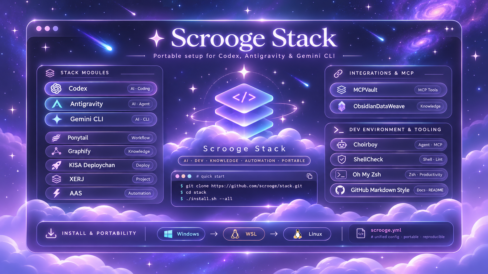

<div align="center">

# ✦ Scrooge Stack

**Portable setup for Codex, Antigravity and Gemini CLI**



<sub>Stack overview · Follow the <a href="#requirements-and-installation">installation instructions below</a> for current commands and options.</sub>

[](https://github.com/SkrudjReal/scrooge-stack/stargazers)
[](https://github.com/SkrudjReal/scrooge-stack/issues)

[Installation](#requirements-and-installation) · [GitHub style](#github-publication-style) · [Verification](#verification-and-limitations)

</div>

Scrooge Stack is an installation and configuration bundle for coding agents. It adapts the original [KISA Stack](https://github.com/howdeploy/kisa-stack) conventions to a portable, user-owned setup; it does not run a Scrooge MCP server. The archived skills and desktop files in this repository remain separate from the installer.

| Component | Purpose |
| --- | --- |
| [Ponytail](https://github.com/DietrichGebert/ponytail) | Explicitly requested coding/review skills; no automatic plugin hooks installed. |
| [Graphify](https://github.com/Graphify-Labs/graphify) | Optional, explicitly requested knowledge graphs; existing skill installations are preserved. |
| [KISA Deploychan](https://github.com/howdeploy/deploychan_mcp) | Optional remote technical catalog at `https://mcp.deploychan.webcam/mcp`. |
| [XERJ](https://github.com/xerj-org/xerj) | Upstream search binary and its native MCP adapter. No server is started and nothing is indexed by the installer. |
| [AAS](https://github.com/sickn33/agentic-awesome-skills) | Local skill collection. Scrooge supplies `aas-skill-selector`, which is not an upstream AAS skill. |
| [GitHub Markdown style](skills/github-markdown-style/SKILL.md) | Automatic agent instruction before each GitHub push, using the owner's visual reference. |
| [ShellCheck](https://www.shellcheck.net/) | Static analysis for shell scripts; installed on Ubuntu/WSL when missing. |
| [Oh My Zsh](https://github.com/ohmyzsh/ohmyzsh) | Optional Ubuntu/WSL shell configuration. |
| [MCPVault](https://github.com/bitbonsai/mcpvault) + [ObsidianDataWeave](https://github.com/howdeploy/ObsidianDataWeave) | Existing Obsidian vault access, SQLite FTS5 recall, MOC/Zettelkasten and LLM Wiki. Local stdio, read-only by default. |
| [Choirboy Prompt](https://github.com/howdeploy/choirboy-prompt) | Optional user-owned persistent project context, staged last and not activated by default. |

## Requirements and installation

Targets are Codex CLI (`codex`), Antigravity CLI (`agy`), and Gemini CLI (`gemini`). Install each selected CLI and Git first. Linux additionally requires Python 3, curl, tar and sha256sum; Graphify requires an existing `graphify`, or `uv` or `pipx`; zsh is required unless skipped. Obsidian setup requires **Python 3.11+ (with venv/pip) and Node.js >=22.12 with npm** on both platforms; use `--skip-obsidian` / `-SkipObsidian` to omit it. Windows requires PowerShell 5.1 or newer, Git and the selected CLIs. Windows and WSL use independent homes and must be configured separately. No AI CLI or login shell is installed or changed.

Ubuntu or WSL:

```bash
bash install.sh --dry-run --targets codex,agy,gemini
bash install.sh --targets codex,agy,gemini
# Optional: --skip-xerj, --skip-zsh, --skip-obsidian
# Select an existing vault explicitly when auto-discovery is ambiguous:
bash install.sh --targets codex --obsidian-vault "$HOME/Documents/My Vault"
# Enable writes only after the built-in temporary tests and verified backup:
bash install.sh --targets codex --obsidian-vault "$HOME/Documents/My Vault" --obsidian-write
```

Windows 10/11, in PowerShell:

```powershell
powershell -NoProfile -ExecutionPolicy Bypass -File .\install.ps1 -DryRun -Targets codex,agy,gemini
powershell -NoProfile -ExecutionPolicy Bypass -File .\install.ps1 -Targets codex,agy,gemini
# Optional: -SkipXerj, -SkipObsidian
.\install.ps1 -Targets codex -ObsidianVault 'C:\Users\you\Documents\My Vault'
.\install.ps1 -Targets codex -ObsidianVault 'C:\Users\you\Documents\My Vault' -ObsidianWrite
```

The ordered steps are Ponytail, Graphify, Deploychan, XERJ, AAS, ShellCheck and Oh My Zsh (Linux/WSL only), Obsidian, global instructions, then Choirboy. A failure stops the run; previously completed steps are not rolled back automatically. Correct the error and rerun. Dry-run prints intended actions without applying changes; it does not prove a download, CLI registration, or endpoint will work.

On Ubuntu/WSL, an existing ShellCheck is reused; otherwise the installer runs `sudo apt-get install -y shellcheck` (or `apt-get` as root). This may request the administrator password. If package lists are stale, run `sudo apt-get update` and retry. Check shell scripts with `shellcheck install.sh scripts/*.sh`. ShellCheck also runs on Windows when installed separately, but it checks shell scripts, not PowerShell; the PowerShell installer does not install it.

## Configuration and security

Global instructions are merged into a marked block in `~/.codex/AGENTS.md` and `~/.gemini/GEMINI.md` (shared by AGY CLI and Gemini CLI). Existing text, including Choirboy blocks, is preserved; invalid markers stop the installer. The OS-specific sources are [Linux/WSL](prompts/linux/AGENTS.md) and [Windows](prompts/windows/AGENTS.md). Antigravity IDE may use additional rules at `~/.gemini/config/AGENTS.md`; this installer targets the CLI and does not modify that file.

Deploychan uses the existing remote service. AGY MCP entries are merged into `~/.gemini/config/mcp_config.json`; Codex and Gemini use their respective CLI and user config. Conflicting existing entries stop the installation rather than replace them. Verify with `codex mcp get deploychan`, `gemini mcp list`, and `agy mcp list`. A registration is not proof that a remote endpoint is available; `gemini mcp list` may connect to configured servers.

XERJ is pinned to `v1.0.0-rc.100`; the official release archive and its upstream SHA-256 file are downloaded over HTTPS and compared before extraction. Both files come from the same upstream release, so this is an integrity check, not independent signature verification. Existing XERJ binaries on PATH are reused. The wrappers explicitly bind the node to loopback, use upstream authentication, and load the local `admin.key` only at MCP startup. They do not start the node automatically. Start it manually only when needed:

```bash
~/.local/share/scrooge-stack/bin/xerj-start.sh
```

```powershell
powershell -NoProfile -ExecutionPolicy Bypass -File "$env:LOCALAPPDATA\scrooge-stack\bin\xerj-start.ps1"
```

Index only paths you have chosen using the [upstream XERJ documentation](https://www.xerj.org/docs/cli). Stop the node with Ctrl+C. Never put the admin key into an agent config.

The AAS checkout is large and copying its skills can consume significant disk space. Skills are loaded on demand by the agent, not all at once. Existing skill directories are never overwritten. Ponytail and Graphify's newly installed skill descriptions require explicit user invocation; existing copies and hooks are left unchanged, so review old automatic integrations yourself.

On Linux/WSL, the installer clones missing Oh My Zsh and the two plugins, then updates only `ZSH_THEME`, `plugins`, and the `:omz:update` policy. Existing `.zshrc` requires exactly one Oh My Zsh source line; ambiguous or unsupported settings stop with an error instead of rewriting the file. A new `.zshrc` receives the required source line. Oh My Zsh's own automatic update is enabled; no background job rewrites `.zshrc`.

## GitHub publication style

Both full installers copy [github-markdown-style](skills/github-markdown-style/SKILL.md) into each selected host's skills directory and merge its invocation rule into the global `AGENTS.md` / `GEMINI.md` instructions. Codex respects `CODEX_HOME`; AGY uses `~/.gemini/config/skills`, Gemini uses `~/.gemini/skills`. Existing skill directories and personal instructions are preserved. The `--only-obsidian` / `-OnlyObsidian` mode remains limited to Obsidian.

Before every agent-driven GitHub push, including code-only pushes, the agent must read the skill and check relevant outgoing Markdown against [example-git-markdown](https://github.com/SkrudjReal/example-git-markdown). The style uses violet badges, a centered README introduction, clear sections, tables, alerts and collapsible details where useful. Issues and PRs use a compact version. Project facts and existing content take priority over decoration; supplied images are inserted unchanged unless editing is requested. Code-only pushes do not require artificial documentation changes.

The agent reads the live reference when accessible; the skill also contains offline style rules. This is a global agent instruction, not a vendor system-prompt modification or Git hook: manual shell pushes do not invoke it, and it grants no extra publication permission. After updating this checkout, rerun the full installer for the desired targets and restart the agent. Existing copies of the skill are intentionally not overwritten; review any local version before replacing it.

## Obsidian knowledge integration

To add only Obsidian to an existing setup, without reinstalling other stack components:

```bash
bash install.sh --only-obsidian --targets agy,gemini --obsidian-vault "$HOME/Documents/My Vault" --obsidian-write
```

```powershell
.\install.ps1 -OnlyObsidian -Targets 'agy,gemini' -ObsidianVault 'C:\Users\you\Documents\My Vault' -ObsidianWrite
```

This mode requires the Obsidian prerequisites below, but does not require the selected agent CLI to be installed yet. Omit the write flag for read-only setup. Run each command in its native environment; Windows and WSL need separate installations.

Both installers call the same [Python helper](scripts/install-obsidian.py), so native Windows needs no Bash. It discovers an existing vault from the configured Codex MCP path, Obsidian's vault registry or common Documents locations (including WSL-mounted Windows profiles). It does not recursively search the whole disk or create a new vault. If none is found it skips this component with a rerun instruction; multiple candidates require `--obsidian-vault` / `-ObsidianVault`.

MCPVault is pinned to npm **0.18.3** and installed into Scrooge's user data directory. New DataWeave checkouts use official upstream commit `ddc40c68941d66943824c668ed192aced866fce8`, plus reviewed [integration](obsidian/dataweave.patch), [portable-path](obsidian/dataweave-portable-paths.patch) and [Windows YAML](obsidian/dataweave-windows-yaml.patch) patches and their regression tests. The patch prunes inaccessible/system caches before vault traversal, avoids external symlinks during scans, contains generated note destinations within the vault, supplies the required atom-plan JSON contract, normalizes stored relative paths across OSes and escapes Windows source paths in YAML. It includes no personal notes, paths or credentials. Existing checkouts are reused without checkout/reset/pull; an incompatible patch or unexpected origin stops safely. Upstream attribution is retained in [DATAWEAVE-LICENSE](obsidian/DATAWEAVE-LICENSE).

DataWeave defaults to `~/projects/mainstream/ObsidianDataWeave`; choose an existing/alternative path with `--obsidian-repo` / `-ObsidianRepo`. Dependencies use that project's venv. Linux uses upstream `install.sh --mode codex` for the Codex target; Windows configures native Python scripts directly. Local FTS5 indexing is enabled over the same vault. Its SQLite DB and staging live outside the vault under Scrooge user data, preserving any existing DataWeave config pointing to the same vault. Other vault/config conflicts are reported without replacement.

The helper registers one `mcpvault` stdio server for selected hosts, preserving other MCP entries: Codex `~/.codex/config.toml` (or CODEX_HOME), AGY `~/.gemini/config/mcp_config.json`, Gemini `~/.gemini/settings.json`. A compatible existing MCP entry is retained, including already-authorized write access. A conflicting server stops installation. Config changes get timestamped backups. Eleven read tools are automatically approved for new Codex entries; mutations retain Codex confirmation. AGY/Gemini retain their host's normal approval policy.

The generated `obsidian-dataweave-codex` skill in each selected host's skills directory records machine-specific vault/repo/venv paths and supports all nine knowledge workflows: source-backed search and summary, research saving, atomization, MOCs, related notes, duplicate previews, incremental FTS5 and Wiki compile/update. Existing user-authored skills are not overwritten; review them or skip this component if a conflict is reported. Native semantic rewrite/compile uses an already-installed Codex (`--backend codex`); AGY/Gemini can use interactive MCP and non-LLM plan/render/index workflows, but DataWeave has no agy/gemini rewrite backend.

The helper also merges a separate `scrooge-obsidian` instruction block into Codex `AGENTS.md` and/or shared `~/.gemini/GEMINI.md`. Existing instructions, including the full-stack block, are preserved; reruns update only the Obsidian block.

**Safety:** new installations are read-only. Explicit write enablement first runs real stdio and native DataWeave probes against temporary vaults, then copies and SHA-256 verifies the selected vault before changing MCP args. Snapshots are under `<obsidian-data>/backups/`; `.smart-env`, `.git` and `.trash` are excluded, symlinks are preserved without following them, and the sibling manifest records hashes/exclusions. A later ordinary rerun preserves previously enabled writes and does not produce another backup. Before later bulk work, make a fresh backup and obtain explicit approval after a path/link-impact preview. Agent instructions are not an OS sandbox around trusted MCP clients.

Obsidian and its REST API plugin need not run. No additional MCP server, port, embedding model or Smart Connections is installed. The upstream NotebookLM Python dependency is installed, but no account login, browser or Google Drive setup is initiated. No LLM generation is invoked by installer smoke tests. The real vault is only read/indexed/backed up during installation; mutations are tested only in temporary fixtures.

After installation restart Codex/your selected agent and reload the IDE extension. CLI and IDE share configuration only on the same host/HOME/CODEX_HOME; run the appropriate installer separately for native Windows and WSL. For native Windows Python workflows, set `$env:PYTHONUTF8='1'; $env:PYTHONIOENCODING='utf-8'` in that terminal before invoking DataWeave; the installer does this for its child processes automatically.

Example prompts:

1. “Найди мои заметки об AI-агентах, обобщи и укажи источники”.
2. “Сохрани это исследование с источниками, тегами и ссылками на существующие заметки”.
3. “Разбей эту заметку на атомарные Zettelkasten-заметки, обнови MOC и сохрани исходник”.
4. “Найди связанные и пересекающиеся заметки; покажи план объединения, ничего не удаляй”.
5. “Обнови FTS5 и добавь новый материал в LLM Wiki, затем проверь ссылки”.

See [Obsidian verification](obsidian/VERIFICATION.md) for commands, actual results and limits.

## Choirboy and personal memory

The public Choirboy checkout contains its author's personal lore. The default last step only stages that checkout; it never activates its context. To enable Choirboy, first review and replace the upstream `lore.md`, `user.md` and other personal material with your own actual project context, verify the upstream installer and create a nonempty `.scrooge-personalized` file in that checkout. On Windows, install PowerShell 7 (`pwsh`) before activation; this prevents the upstream bootstrapper from installing it automatically. Then rerun with `--choirboy-source /path/to/personalized/checkout` or `-ChoirboySource 'C:\path\to\personalized\checkout'`. The marker is an acknowledgement, not proof that every file was personalized. Choirboy's official installer runs last and manages its own blocks; inspect its changes and use its uninstall instructions if needed. Never edit persistent memory without the owner's explicit request.

## Updates, rollback and troubleshooting

Reruns reuse existing Git checkouts and skill directories; they do not automatically update source checkouts. Review upstream changes before manually updating a clean checkout, then reinstall deliberately. Existing configuration files are backed up with `.bak.<timestamp>` before Scrooge changes them. To roll back, close the agent, compare the backup with the current file, and restore only the desired version; remove Scrooge's marked prompt block and MCP entries with the corresponding agent CLI if appropriate. Remove only skill directories and source checkouts you intentionally installed, not pre-existing ones. For Choirboy use the upstream uninstaller. XERJ data is separate from the binary and should only be deleted deliberately.

If a selected CLI or prerequisite is missing, install it and rerun. A failed clone can leave a partial directory: inspect it and move it aside before retrying. For malformed JSON or conflicting MCP entries, repair the named file manually; the installer does not overwrite the conflicting entry. For ambiguous `.zshrc` settings, resolve them manually before rerunning. Check connectivity and authentication separately when a configured MCP server cannot connect.

## Verification and limitations

The repository includes isolated Linux tests and a Windows PowerShell 5.1 mocked integration test; run `python3 -m unittest discover -s tests -v` and `powershell -NoProfile -File .\tests\windows-integration.ps1`. Their coverage does not prove real installations of every upstream version or architecture. ARM64, PowerShell 7, complete real Windows installations, and live Gemini CLI connections need platform-specific verification. Real Codex and AGY configuration discovery and XERJ MCP initialization were checked in isolated Linux homes; other installer dependencies in those runs were mocked. Most upstream Git checkouts are not version pinned; Obsidian pins are documented above. Review upstream content and update policy. No background service or custom MCP server is supplied.

The original single archived-skill installer remains available as `scripts/install-archived-skill.sh`; see [skills/README.md](skills/README.md). Attribution and licenses of upstream components remain with their respective authors.
